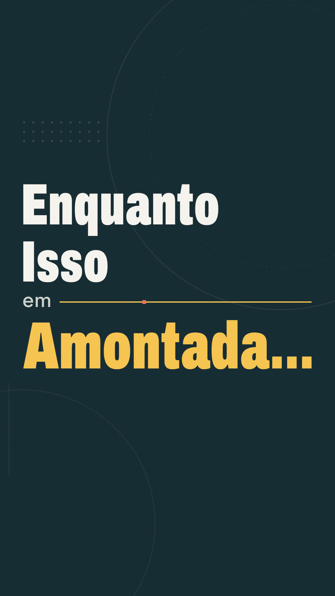

# Vinheta — “Enquanto Isso em Amontada…”

Vinheta de abertura do quadro de Rackel Sousa (@rackelsousa00) no Instagram.
Vertical 9:16, 1080 × 1920, 30 fps, **3,5 s (105 quadros)**, trilha original sintetizada em código.
Projeto em **React + TypeScript + Remotion**, editável e determinístico: o mesmo comando gera sempre os mesmos quadros e o mesmo áudio.



## Entregáveis (`output/`)

| Arquivo | O que é |
|---|---|
| `enquanto-isso-em-amontada.mp4` | Vinheta final. H.264 High, yuv420p, CRF 16, 30 fps · AAC 320 kb/s, 48 kHz, estéreo |
| `enquanto-isso-sem-audio.mp4` | A mesma imagem, sem faixa de áudio |
| `capa-vinheta.png` | Quadro 70: composição final completa (1080 × 1920) |
| `trilha-vinheta.wav` | Identidade sonora: 3,5 s, 48 kHz, estéreo, 24 bits, −14 LUFS, pico real −1,3 dBTP |
| `enquanto-isso-alfa-elementos.mov` | ProRes 4444 com transparência: só tipografia, fio, faixa e cortina (sem fundo) |
| `enquanto-isso-alfa-transicao.mov` | ProRes 4444 com transparência: vinheta completa; a cortina final **revela a reportagem** que estiver embaixo |

### Como usar na edição

- **Mais simples:** coloque `enquanto-isso-em-amontada.mp4` no início e corte para a reportagem no fim do arquivo. O último quadro já é a cortina saindo, sem tela preta nem pausa.
- **Transição de verdade (CapCut, Premiere, DaVinci, Final Cut):** coloque a reportagem na trilha de baixo, começando junto com a vinheta, e `enquanto-isso-alfa-transicao.mov` na trilha de cima. Por 3 s a vinheta cobre tudo. No acerto final (3,0 s) a cortina dourada passa e deixa a primeira imagem da reportagem à vista, já em movimento. Use `trilha-vinheta.wav` como áudio.
- **Sobre imagens:** `enquanto-isso-alfa-elementos.mov` põe só o título animado sobre qualquer vídeo. Funciona melhor sobre imagens escuras ou com o fundo levemente desfocado.

## Conceito

**O fio da reticência.** “Enquanto isso…” é uma frase que fica em suspenso: algo está acontecendo e você está prestes a saber. Os três pontos da reticência são a assinatura do quadro. Eles abrem a vinheta, viram o fio que revela o título, voltam no fim de “Amontada…” e pulam como alguém digitando antes da cortina. O som segue a mesma ideia: três notas fazem a pergunta no começo, e as mesmas três notas trazem a resposta no fim.

Tudo é desenhado a partir da própria fonte. Os pontos da abertura são retângulos com as proporções exatas do ponto final da Archivo (0,143 × 0,179 em), então a reticência de “Amontada…” e os pontos que abrem a vinheta são o mesmo objeto.

### Storyboard (120 bpm: 1 batida = 0,5 s = 15 quadros)

| Tempo | Quadros | Imagem | Som |
|---|---|---|---|
| 0,00–0,45 s | 0–13 | Fundo petróleo com grão e linhas finas (círculos, arco, grade de pontinhos) já em deriva, em três profundidades. Os três pontos dourados surgem um por acerto (0,125 / 0,25 / 0,375 s) e se esticam no fio, que atravessa a tela | Motivo “reticência”: Dó#–Mi–Fá# em pluck FM, da esquerda para a direita. Whoosh suave subindo com o fio |
| 0,45–1,10 s | 13–33 | “Enquanto” e “Isso” sobem de trás de máscaras horizontais, letra por letra, com overshoot de mola (~10 %) e o espaçamento se fechando | **0,5 s:** impacto sutil (baque grave + ar) e entra o pulso: bumbo, baixo, pad Fá#m9 |
| 1,10–1,85 s | 30–57 | O bloco sobe e abre espaço; o fio vira a régua do “em”, que sai de trás da ponta do fio. **1,5 s:** a faixa dourada corre da esquerda e pousa com “Amontada…” vazado em petróleo. **1,75 s:** a faixa recolhe para a direita e deixa o nome em dourado | Sopro curto (1,0 s), toque de madeira no “em” (1,25 s), deslize lateral + pouso (1,5 s; harmonia vai para Ré7M9), “zíper” (1,75 s) |
| 1,85–2,95 s | 57–88 | Composição final legível por mais de 1 s. Um marcador coral percorre o fio (o tempo passando, “enquanto isso”). O fundo deriva quase imperceptível. **2,625 / 2,75 / 2,875 s:** os três pontos da reticência pulam | “Tic” na assinatura (2,0 s), chimbal em semicolcheias, Mi sus. Motivo de resposta Dó#–Mi–Lá nos três pulos |
| 2,95–3,50 s | 85–104 | O título se inclina para a direita (cada linha numa velocidade). A cortina varre da esquerda para a direita: faixa coral fina, painel dourado cobrindo o quadro no acerto, saída pela direita com o coral fechando | Whoosh para a cortina, **respiro de 40 ms** e **acento final em 3,0 s**: acorde Lá 6/9, sino, bumbo; o rastro acompanha a cortina e o som soa até o fim com fade-out |

### Direção de arte

- **Cores** (`src/config/brand.ts`): petróleo `#152A31` (fundo), branco quente `#F5F3ED` (“Enquanto Isso”, “em”, linhas), dourado `#F5C451` (“Amontada…”, fio, faixa, cortina), coral `#EF715B` só no marcador do fio e nas bordas da cortina.
- **Tipografia:** uma fonte de título, **Archivo** variável em peso 900 e largura 62,5 % (extracondensada), com kerning medido letra a letra. Uma fonte de interface, **Space Grotesk** 500, só no “em”.
- **Hierarquia:** “Enquanto / Isso” em branco, 188 px · “em” discreto, 66 px, preso ao fio · “Amontada…” em dourado, 215 px, a linha mais larga.
- **Zona segura:** o texto fica entre x = 75–1004 e y = 593–1189. Isso é dentro da área livre dos Reels (250 px no alto, 670 px embaixo, 65 px nos lados) e do recorte 4:5 do feed. Conferido automaticamente.

### Trilha (`audio/gerar_trilha.py`)

Toda sintetizada em Python (numpy/scipy), sem amostras nem música de terceiros. Os timbres são pluck FM com baqueta (os pontos), pad de serras com filtro abrindo ao longo da vinheta, bumbo com saturação leve (o grave aparece no celular), baixo em colcheias “respirando” com o bumbo (sidechain), chimbal, estalo e efeitos de ruído filtrado com varredura. A reverberação é por convolução com resposta ao impulso sintética. Todo ruído vem do gerador **mulberry32** com semente fixa.
Harmonia: Fá#m9 → Ré7M(9) → Mi sus → Lá 6/9. É curiosa e resolve para cima, sem clima de plantão policial.
Masterização: corte de subgrave (38 Hz), normalização para **−14 LUFS** e limitador com detecção de pico real 4× (**≤ −1 dBTP**), com fade-in e fade-out.

## Comandos

```bash
npm install                  # dependências (Remotion 4.0.538, React 19)
npm run studio               # pré-visualizar e ajustar no Remotion Studio (navegador)
npm run audio                # regera public/audio/trilha-vinheta.wav e beats.json
npm run render               # todos os entregáveis em output/ + folha de contato em qa/
npm run folha                # só a folha de contato (um quadro por batida e por acerto)
npm run verificar            # conferência técnica → qa/relatorio.md
npm run tudo                 # áudio + render + conferência
node render.mjs --sem-alfa   # entregáveis sem as versões ProRes
node render.mjs --so-alfa    # só as versões ProRes 4444
node render.mjs --tira=40-58 # todos os quadros de um intervalo, para conferir movimento
```

Requisitos: Node 18+, Python 3.10+ com `numpy scipy pyloudnorm` (e `matplotlib` só para `tools/espectrograma.py`), ffmpeg/ffprobe para a conferência. A folha de contato usa o Playwright se estiver instalado; sem ele, os quadros ficam soltos em `qa/quadros/`.

## Como editar

| Quero mudar… | Onde |
|---|---|
| Cores, fontes, tamanhos, posições das linhas | `src/config/brand.ts` |
| Andamento, acertos (em batidas), quadro da capa | `src/config/timeline.json`. Vídeo **e** áudio leem daqui: rode `npm run audio` e `npm run render` |
| Duração de cada movimento em relação ao acerto | `src/config/coreografia.ts` |
| Curvas e molas | `src/lib/motion.ts` |
| Timbres, harmonia, mixagem | `audio/gerar_trilha.py` |

### Estrutura

```
src/
  config/      brand.ts (identidade) · timeline.json (tempo) · coreografia.ts (movimentos)
  lib/         fonts.tsx (carrega as fontes antes do 1º quadro) · measure.ts (kerning)
               layout.ts (geometria) · motion.ts (curvas, molas, mulberry32)
  components/  Fundo.tsx (fundo, linhas, grão) · Fio.tsx (pontos → fio → régua)
               Linhas.tsx (“Enquanto Isso”, “em”) · Cidade.tsx (faixa e “Amontada…”)
               Cortina.tsx (saída)
  Vinheta.tsx  composição (modos: completo, alfaElementos, alfaTransicao)
  Root.tsx     composições registradas no Remotion
audio/gerar_trilha.py   trilha e efeitos
tools/verificar.py      conferência técnica · tools/espectrograma.py
render.mjs              render de todos os entregáveis
beats.json              grade de batidas + ataques medidos no MP4 final
public/fonts/           Archivo e Space Grotesk (woff2, OFL)
qa/                     folha de contato, espectrograma, teste de sobreposição, relatório
```

## Determinismo

Cada quadro é uma função pura do número do quadro (`useCurrentFrame`), o equivalente no Remotion ao `window.seek(t)` das regras do estúdio. Não há animação de CSS, timer nem estado passado de um quadro para o outro. O grão usa `feTurbulence` com semente tirada do mulberry32 e o áudio usa mulberry32 vetorizado. Nada usa `Math.random`. As fontes são carregadas do próprio projeto e o render espera por elas (`delayRender`), então nenhum quadro sai com fonte substituta.

## Conferência

`npm run verificar` confere: 1080 × 1920, 30 fps, 105 quadros, 3,500 s, H.264 yuv420p e AAC 48 kHz estéreo. Também mede −14,0 LUFS e −1,3 dBTP, confirma que a trilha está presente e que o estéreo é real, que o fim não tem corte seco, que **cada acerto da timeline tem um ataque medido no áudio a ≤ 9 ms** e uma mudança de imagem no mesmo quadro, que não há quadro vazio e que o texto está na zona segura. Resultado em `qa/relatorio.md`. A folha de contato está em `qa/folha-por-batida.png`.

Notas do ciclo de revisão (regra do estúdio: tudo ≥ 8 antes do render final):

| Critério | Nota | O que foi corrigido para chegar lá |
|---|---|---|
| Gancho nos 2 primeiros segundos | 8 | os pontos chegam no quadro exato do acerto (antes apareciam 1 quadro depois); o fundo já está em movimento no quadro 0 |
| Leitura em tela de celular | 8 | título 12 % maior; “em” de 58 para 66 px; tudo dentro da zona segura dos Reels |
| Qualidade do movimento | 8 | o “em” encostava em “Isso” durante a subida; emendas do fio; pulo dos pontos sem deformar |
| Variedade | 9 | algo novo a cada 0,25–0,5 s; a saída inclina cada linha numa velocidade |
| Fidelidade à marca | 8 | coral reduzido a faixas finas (estava ocupando 1/3 da tela na cortina) |
| Sincronia do som | 9 | o acento final não tinha ataque nítido (o whoosh o mascarava): respiro de 40 ms antes do acerto; subgrave enxugado |

## Licenças

- **Archivo** (Omnibus-Type) e **Space Grotesk** (Florian Karsten): SIL Open Font License 1.1. Os textos estão em `public/fonts/OFL-*.txt`.
- **Trilha e efeitos:** originais, gerados por `audio/gerar_trilha.py` neste projeto. Não há amostras, loops ou música de terceiros.
- **Elementos gráficos:** abstratos e desenhados em código (sem mapas, monumentos nem imagens de terceiros).
